<p align="center">
  
</p>

<p align="center">
  <a href="https://portfolio-miguel-ribas.vercel.app"><b>portfolio</b></a> &nbsp;·&nbsp;
  <a href="https://www.linkedin.com/in/miguel-ribas-berlese-2927b0339"><b>linkedin</b></a> &nbsp;·&nbsp;
  <a href="mailto:miguelberlese14@gmail.com"><b>email</b></a>
</p>

<br/>

### `$ cat README.md`

I build software that replaces spreadsheets, manual work and guesswork with systems that run on their own.
Full-stack by trade, with a soft spot for **LLM integrations** and **automation** — from the first requirement to the deploy.
Software Engineering student at **UNAERP** (class of 2027), based in **Ribeirão Preto, Brazil**.

<br/>

### `$ ls ./projects --featured`

<table>
<tr>
<td width="50%" valign="top">

**MintBoard** &nbsp;`SaaS · beta`<br/>
CRM for digital agencies — sales pipeline, projects, tasks, finance and subscription billing, with AI built in.<br/>
<sub>React · Node.js · PostgreSQL · Claude API · Stripe</sub>

</td>
<td width="50%" valign="top">

**[RadarLinka](https://radar-olive-five.vercel.app)** &nbsp;`live`<br/>
AI-powered event aggregator for Ribeirão Preto: collects events from many sources and organizes them with an LLM.<br/>
<sub>Python · Groq · Vercel</sub>

</td>
</tr>
<tr>
<td width="50%" valign="top">

**LINKA Ecosystem** &nbsp;`in development`<br/>
Local platform for events, maps and local commerce, on web and mobile.<br/>
<sub>React · Firebase · Flutter</sub>

</td>
<td width="50%" valign="top">

**boipreto** &nbsp;`live`<br/>
Institutional website for an agribusiness consultancy, with motion-driven UI.<br/>
<sub>React 19 · TypeScript · Tailwind · Motion</sub>

</td>
</tr>
</table>

<br/>

### `$ stack --list`

```yaml
frontend:    React 19 · TypeScript · Vite · TailwindCSS
backend:     Node.js · NestJS · Python · PHP · Java
data:        PostgreSQL · Prisma · Firebase
ai:          Claude API · Groq · Playwright · BeautifulSoup
automation:  n8n · webhooks · REST APIs
mobile:      Flutter · Dart · Kotlin
infra:       Vercel · Cloudflare · Git
```

<br/>

### `$ now`

| building | learning | open to |
|:--|:--|:--|
| SaaS products and custom systems for small businesses | software architecture · Java · RAG and LLM evaluation | junior full-stack, AI and automation roles · freelance |

<br/>

<p align="center">
  <picture>
    <source media="(prefers-color-scheme: dark)" srcset="https://raw.githubusercontent.com/MiguelRibasBerlese/MiguelRibasBerlese/output/snake-dark.svg" />
    
  </picture>
</p>
