  

  
  
  

### about

I build web software end to end: requirements, architecture, code and deploy. Most of it replaces spreadsheets and manual routines with systems that run on their own, usually with an LLM handling the tedious part.

Software Engineering at UNAERP, graduating in 2027. 5th place at the NASA Space Apps Challenge 2025.

  

### stack

### projects

<table>
<tr>
<td></td>
<td></td>
</tr>
<tr>
<td></td>
<td></td>
</tr>
</table>

### activity

### lately

Studying software architecture, Java and how to evaluate LLM output properly.

  

