  

  <a href="https://portfolio-miguel-ribas.vercel.app"><b>portfolio</b></a> &nbsp;✦&nbsp;
  <a href="https://www.linkedin.com/in/miguel-ribas-berlese-2927b0339"><b>linkedin</b></a> &nbsp;✦&nbsp;
  <a href="mailto:miguelberlese14@gmail.com"><b>email</b></a>

### ✦ about

I build software that replaces spreadsheets, manual work and guesswork with systems that run on their own — from the first requirement to the deploy, with a soft spot for **LLM integrations** and **automation**.
Software Engineering student at **UNAERP** (class of 2027), based in **Ribeirão Preto, Brazil** · 5th place at the **NASA Space Apps Challenge 2025**.

### ✦ stack

  

### ✦ projects

<table>
<tr>
<td width="50%"></td>
<td width="50%"></td>
</tr>
<tr>
<td width="50%"></td>
<td width="50%"></td>
</tr>
</table>

### ✦ now

| 🛠️ building | 📚 learning | 🤝 open to |
|:--|:--|:--|
| SaaS products and custom systems for small businesses | software architecture · Java · RAG and LLM evaluation | junior full-stack, AI and automation roles · freelance |

  

